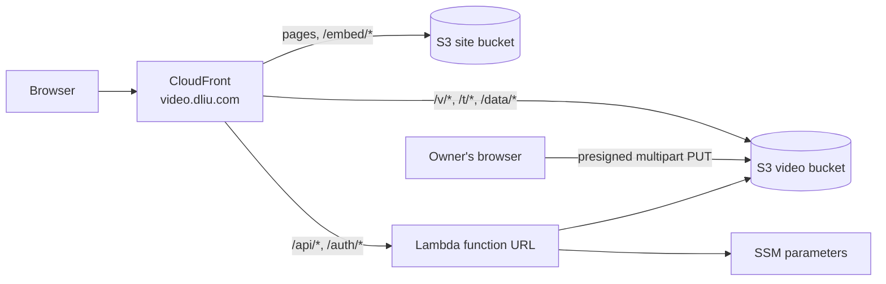

# video.dliu.com

A small, serverless video site. The owner uploads videos after signing in with Microsoft 365. Anyone can watch them. Any video can be embedded in other sites, such as blog.dliu.com.

The live docs at [video.dliu.com/docs](https://video.dliu.com/docs) cover the technical architecture, running costs and security (including a live penetration test).

## How it works



- **Videos are served as uploaded.** There is no transcoding. MP4 (H.264/AAC) plays everywhere; WebM, MOV, M4V and OGV are also accepted. CloudFront serves byte ranges, so seeking works.
- **Uploads go straight from the browser to S3** using presigned multipart URLs. Parts are at least 16 MiB, four upload in parallel, and failed parts are retried. The browser also reads the duration and size and grabs a thumbnail frame.
- **There is no database.** `meta/index.json` in the video bucket is the source of truth and is updated with conditional writes. The Lambda publishes `data/catalog.json` (the list of videos) and `data/videos/<id>.json` (one per video). Pages read these through CloudFront.
- Every video is listed on the home page and can be watched or embedded by anyone with its link.
- **Sign-in** uses Entra OIDC with PKCE, the same as traffic-monitor. Only accounts in the root domain (`@dliu.com`) can manage videos.
- Page views are logged by the shared traffic-monitor visitor function and geo origin request policy.

### Costs

Nothing runs while nobody is using the site, and there is no fixed monthly fee. There are no servers, load balancers, NAT gateways, databases or WAF.

| Resource | You pay for |
| --- | --- |
| S3 | Storage (Intelligent-Tiering for videos) and requests |
| CloudFront | Data transfer and requests. The free tier includes 1 TB and 10M requests per month. |
| Lambda | Invocations. Only page loads by the owner and API calls use it. |
| SSM Parameter Store | Standard parameters, which are free |
| Route 53, ACM | Covered by the existing hosted zone; public certificates are free |

When idle, the only cost is video storage. See [/docs#cost](https://video.dliu.com/docs#cost) for prices and examples.

## Layout

| Path | What |
| --- | --- |
| `lib/video-stack.ts` | The CDK stack |
| `lambda/api/` | API and sign-in Lambda (`index.js` routes, `videos.js` upload/edit/delete, `store.js` S3 data, `auth.js` Entra, `presign.js` SigV4) |
| `functions/pages.js` | CloudFront Function for clean URLs (`/watch`, `/upload`, `/docs`, `/embed/<id>`) |
| `web/` | Static pages: home, watch, upload, embed, and docs (`docs.js` content, `diagram.js` diagram kit from traffic-monitor) |
| `config/site.json` | Subdomain, sites allowed to embed, upload size cap |
| `scripts/set-secrets.sh` | Stores the Entra app credentials in SSM |

## Setup

Requirements: the root `dliu.com` stack (exports `MainDomain`, `MainHostedZoneId`) and traffic-monitor (exports `TrafficVisitorFunctionArn`, `TrafficGeoOriginRequestPolicyId`) must already be deployed in eu-west-1.

1. In the Microsoft Entra app registration, add the **Web** redirect URI `https://video.dliu.com/auth/callback`, and create a client secret. Optionally, set *Enterprise applications → (the app) → Assignment required = Yes* and assign only the people who may upload. The app itself only checks that the account is in the root domain.
2. Store the app credentials (prompts for tenant ID, client ID and client secret; the secret is not echoed):

   ```sh
   make set-secrets
   ```

   They go to SSM as `/video/entra-tenant-id`, `/video/entra-client-id` and `/video/entra-client-secret` (SecureString). Run it again any time to rotate the secret.
3. Install and deploy:

   ```sh
   make install
   make deploy      # runs the unit tests first
   make outputs
   make smoke       # end-to-end test against the live site
   ```

Then open https://video.dliu.com, choose **Sign in**, and upload.

Until the first video is uploaded, `/data/catalog.json` doesn't exist (CloudFront returns 403) and the home page shows an empty list.

## Embedding

On a video's page, choose **Embed**, pick the options, and copy the HTML. It looks like this:

```html
<iframe src="https://video.dliu.com/embed/VIDEO_ID"
  title="Video title"
  style="width:100%;aspect-ratio:16/9;border:0"
  allow="autoplay; fullscreen; picture-in-picture" allowfullscreen loading="lazy"></iframe>
```

Query parameters for `/embed/<id>`:

| Parameter | Effect |
| --- | --- |
| `t=<seconds>` | Start at this time (`start` also works) |
| `autoplay=1` | Start playing straight away. Browsers only allow this when muted, so it also mutes. |
| `muted=1` | Start muted |
| `loop=1` | Loop |

Only the sites in `config/site.json` → `embedAncestors` may frame the player (by default `https://dliu.com` and `https://*.dliu.com`). Add an origin there and redeploy to allow another site. All other pages refuse to be framed.

If the embedding site has its own Content Security Policy, it needs `frame-src https://video.dliu.com`.

## Testing

```sh
make test     # unit tests (Jest): API, auth, presigner, CloudFront Function, stack
make synth
make diff
make smoke    # end-to-end against the deployed site
```

`make smoke` (`scripts/smoke-test.js`) uploads a throwaway 20 MiB video in two parts straight to S3. It then checks CORS, publishing, byte-range serving, the poster, the catalog, the embed headers and editing, and deletes the video. It signs a 10-minute owner session with the key derived from the client secret in SSM, so it needs AWS credentials that can read `/video/*`. Use `node scripts/smoke-test.js --keep` to leave the video in place for a look in the browser.

## Traffic monitoring

The site is registered in traffic-monitor as `video` (`config/sites.json` there, with the distribution ID in its local distributions file). Page views appear on traffic.dliu.com with the other sites. If the distribution is ever replaced, update the ID there and redeploy traffic-monitor.

## Notes

- Deleting a video removes its file, thumbnail and details and invalidates them in CloudFront. Existing embeds stop working.
- Unfinished multipart uploads are aborted by S3 after 2 days. Pending upload records expire after 7 days.
- The video bucket is retained if the stack is deleted. The site bucket is not.
- The site uses a light theme only and adapts from small phones to wide screens, including notches (safe areas) and landscape phones.
- When the code, prices or security checks change, update `web/docs.js`.
