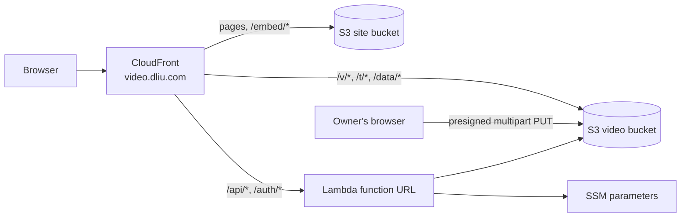

# video.dliu.com

A small, serverless video site. The owner uploads videos after signing in with Microsoft 365. Anyone can watch them. Any video can be embedded in other sites, such as blog.dliu.com.

The docs at [video.dliu.com/docs](https://video.dliu.com/docs) cover the technical architecture, running costs and security (including a live penetration test).
The dedicated [API reference](https://video.dliu.com/docs/api) documents the nine Microsoft-token routes,
request/response fields and the direct-to-S3 multipart workflow. Agents can read the same source at
[/docs/api.md](https://video.dliu.com/docs/api.md); its browser page renders that single Markdown source.

## How it works



- **Videos are served as uploaded.** There is no transcoding. MP4 (H.264/AAC) plays everywhere; WebM, MOV, M4V and OGV are also accepted. CloudFront serves byte ranges, so seeking works.
- **Uploads go straight from the browser to S3** using presigned multipart URLs. Parts are at least 16 MiB, four upload in parallel, and failed parts are retried. The browser also reads the duration and size and grabs a thumbnail frame.
- **There is no database.** `meta/index.json` in the video bucket is the source of truth and is updated with conditional writes. The Lambda publishes `data/catalog.json` (the list of videos) and `data/videos/<id>.json` (one per video). Pages read these through CloudFront.
- Every video is listed on the home page and can be watched or embedded by anyone with its link.
- **Sign-in** uses Entra OIDC with PKCE, the same as traffic-monitor. Only accounts in the root domain (`@dliu.com`) can manage videos.
- Page views are logged by the shared traffic-monitor visitor function and geo origin request policy.

### Costs

Nothing runs while nobody is using the site, and there is no fixed monthly fee. There are no servers, load balancers, NAT gateways, databases or WAF.

| Resource | You pay for |
| --- | --- |
| S3 | Storage (Intelligent-Tiering for videos) and requests |
| CloudFront | Data transfer and requests. The free tier includes 1 TB and 10M requests per month. |
| Lambda | Invocations. Only page loads by the owner and API calls use it. |
| API Gateway HTTP API (optional) | Requests to the Microsoft-token API; no fixed monthly charge |
| SSM Parameter Store | Standard parameters, which are free |
| Route 53, ACM | Covered by the existing hosted zone; public certificates are free |

When idle, the only cost is video storage. See [/docs#cost](https://video.dliu.com/docs#cost) for prices and examples.

## Layout

| Path | What |
| --- | --- |
| `lib/video-stack.ts` | The CDK stack |
| `lambda/api/` | API and sign-in Lambda (`index.js` routes, `videos.js` upload/edit/delete, `store.js` S3 data, `auth.js` Entra, `presign.js` SigV4) |
| `functions/pages.js` | CloudFront Function for clean URLs (`/<id>`, `/embed/<id>`, `/upload`, `/docs`) |
| `web/` | Static pages: home, watch, upload, embed, and docs (`docs.js` content, `docs-api.html` and `docs-api.js` render `docs/api.md`, `diagram.js` diagram kit from traffic-monitor) |
| `config/site.json` | Subdomain, sites allowed to embed, upload size cap |
| `scripts/set-secrets.sh` | Stores the Entra app credentials in SSM |

## Setup

Requirements: the root `dliu.com` stack (exports `MainDomain`, `MainHostedZoneId`) and traffic-monitor (exports `TrafficVisitorFunctionArn`, `TrafficGeoOriginRequestPolicyId`) must already be deployed in eu-west-1.

1. In the Microsoft Entra app registration, add the **Web** redirect URI `https://video.dliu.com/auth/callback`, and create a client secret. Optionally, set *Enterprise applications → (the app) → Assignment required = Yes* and assign only the people who may upload. The app itself only checks that the account is in the root domain.
2. Store the app credentials (prompts for tenant ID, client ID and client secret; the secret is not echoed):

   ```sh
   make set-secrets
   ```

   They go to SSM as `/video/entra-tenant-id`, `/video/entra-client-id` and `/video/entra-client-secret` (SecureString). Run it again any time to rotate the secret.
3. Install and deploy:

   ```sh
   make install
   make deploy      # runs the unit tests first
   make outputs
   make smoke       # end-to-end test against the live site
   ```

Then open https://video.dliu.com, choose **Sign in**, and upload.

Until the first video is uploaded, `/data/catalog.json` doesn't exist (CloudFront returns 403) and the home page shows an empty list.

## Microsoft-issued API access

The optional API uses Microsoft-issued access tokens for the shared **dliu API** Entra resource, not the
Video website's app registration. **Authentication is required:** configure your requester using the
[Auth API documentation](https://auth.dliu.com/docs/api), the canonical guide for credential lookup,
token acquisition, storage, expiry/renewal and authenticated request setup.
Website sign-in, session cookies, public playback and embeddings stay unchanged. No API tokens are created by Video.

An API Gateway HTTP API validates Microsoft's access-token signature, tenant-specific v2 issuer, audience,
expiry and the route's delegated scope. The Lambda accepts this identity only from the configured gateway,
requires the approved client application's `azp` and the Microsoft-issued shared `api.access` user role, and
never falls back to a browser cookie on this entry point. The website API still requires its session and
same-origin checks. Arbitrary headers cannot supply gateway identity.

### Entra configuration

1. On the shared **dliu API** registration, request v2 access tokens (`api.requestedAccessTokenVersion: 2`).
   Define admin-consent-only delegated scopes `video.read`, `video.write` and `video.delete`.
2. Use the shared user-only app role **dliu API user** (value `api.access`), common to the Video, Files, Blog
   and Trip planner APIs. It grants no operation by itself: every route still needs its exact `video.*` scope.
   On **Enterprise applications > dliu API**, enable **Assignment required** and assign only approved
   `dliu.com` users to this role. Do not assign guests. The former `video.access` role is not accepted.
   Manage access there, not in a local email/user allowlist. On Entra Free, assign users individually.
3. Use the shared resource/client configuration from the [Auth API documentation](https://auth.dliu.com/docs/api).
   Store these three non-secret **String** parameters in eu-west-1:

   | Parameter | Value |
   | --- | --- |
   | `/video/api-tenant-id` | The Entra directory ID |
   | `/video/api-audience` | The shared dliu API application/client ID (a GUID, without `api://`) |
   | `/video/api-client-id` | The same shared dliu API application/client ID (the only approved SPA `azp`) |

4. Set `microsoftApi` to `true` in `config/site.json`, deploy the whole Video stack, and obtain
   `MicrosoftApiUrl` from `make outputs`. Keep the flag enabled on subsequent deployments.
   The CDK entry point is opt-in; this checkout now enables the managed API after approval.

The shared Auth configuration, SSM values and live deployment must be completed before use.
An unconfigured checkout must keep `microsoftApi: false` until those prerequisites and deployment are explicitly approved.
Authenticated standard-user gateway success remains unverified.

Use the **MicrosoftApiUrl** endpoint for bearer requests, not `https://video.dliu.com/api/*`:
CloudFront's existing origin access control signs the website's requests with AWS IAM credentials.
The new gateway invokes the same Lambda directly with AWS-scoped invoke permission. It has no
unauthenticated default route, sign-in callback or logout route. There is no public managed API
hostname until deployment; initially use the AWS-generated endpoint from that output.

| API routes | Required delegated scope |
| --- | --- |
| `GET /api/me`, `GET /api/videos` | `video.read` |
| `POST /api/uploads`, `/api/uploads/parts`, `/api/uploads/complete`, `/api/uploads/abort` | `video.write` |
| `POST /api/videos/update`, `POST /api/videos/poster` | `video.write` |
| `POST /api/videos/delete` | `video.delete` |

### Video request examples

These examples assume credentials and an authenticated requester configured per the
[Auth API documentation](https://auth.dliu.com/docs/api). With Node.js 22+ and `npm ci`, run from this checkout:

```bash
export VIDEO_API_URL='https://<api-id>.execute-api.eu-west-1.amazonaws.com' # MicrosoftApiUrl
node scripts/api-client.js GET /api/me
node scripts/api-client.js GET /api/videos
```

For changes, Video requires `video.write` or `video.delete` as appropriate; use a route above,
for example `node scripts/api-client.js POST /api/videos/update '{"id":"<video-id>","title":"Updated title"}'`.

A `401` requires checking the endpoint and requester setup using the Auth API documentation.
A `403` requires checking the approved SPA client, assigned-user `api.access` role and route scope;
`video.write` alone does not grant `video.delete`. There is no fallback to website cookies.
The API enforces the scopes Microsoft actually issued. Video provides no token-management or refresh endpoint.
This configuration is for users, not unattended application credentials; app-only access needs a
separate explicit authorization design.

Managed Video code does not cache raw Microsoft bearer tokens in application-global state, persist
them in S3/SSM or log bearer headers/full request events across Lambda invocations. Reused AWS clients,
website configuration and public signing keys are separate caches, not API-token caches.
Request-local values and warm-runtime memory may remain until garbage collection; no forensic
zeroization is promised. Website sign-in, playback and embeds are unchanged.

The API accepts only the single client configured in `/video/api-client-id`. Tokens come only from
Central Microsoft sign-in at auth.dliu.com; `scripts/api-client.js` has no sign-in of its own.

### Optional live smoke test

Only with explicit approval for a live upload/edit/delete test, after requester setup per the
[Auth API documentation](https://auth.dliu.com/docs/api) and Video deployment are complete,
set `VIDEO_API_URL` to `MicrosoftApiUrl` and use all three Video scopes, then run:

```sh
node scripts/smoke-test.js --microsoft
```

This creates and deletes its own throwaway video and consumes one video ID. It does not read the
website client secret. S3 uploads still use temporary AWS-presigned URLs; video bytes never pass
through API Gateway. This is not a read-only authentication check.

## Video IDs

A video's ID is its upload date in UK time plus a two-digit number for that day, and its page is `https://video.dliu.com/<id>`:

- `video.dliu.com/2026102700` is the first video uploaded on 27 October 2026.
- `video.dliu.com/2026102701` is the second.

Each upload reserves its number with a conditional write (`pending/<id>.json`, `If-None-Match: *`), so simultaneous uploads get different numbers. Once a video has been published, its number is never reused, even after the video is deleted. `meta/index.json` records the highest number used each day. This matters because video files are cached for a year and embeds must never switch to a different video. A cancelled upload frees its number. The limit is 100 videos a day.

The owner can replace a video's file from its page (**Replace video file**, which opens `/upload?replace=<id>`). The video keeps its number, title, description and embeds; optionally the thumbnail too. The new file goes to `v/<id>-<version>.<ext>`, a key the year-long cache has never seen, then `meta/index.json` and `data/videos/<id>.json` point at it, and the old file is deleted and invalidated in CloudFront. Starting another replacement cancels an unfinished one. `make smoke` uses up one number on each day it runs.

## Embedding

On a video's page, choose **Embed**, pick the options, and copy the HTML. It looks like this:

```html
<iframe src="https://video.dliu.com/embed/2026102700"
  title="Video title"
  style="width:100%;aspect-ratio:16/9;border:0"
  allow="autoplay; fullscreen; picture-in-picture" allowfullscreen loading="lazy"></iframe>
```

Query parameters for `/embed/<id>`:

| Parameter | Effect |
| --- | --- |
| `t=<seconds>` | Start at this time (`start` also works) |
| `autoplay=1` | Start playing straight away. Browsers only allow this when muted, so it also mutes. |
| `muted=1` | Start muted |
| `loop=1` | Loop |

Only the sites in `config/site.json` → `embedAncestors` may frame the player (by default `https://dliu.com` and `https://*.dliu.com`). Add an origin there and redeploy to allow another site. All other pages refuse to be framed.

If the embedding site has its own Content Security Policy, it needs `frame-src https://video.dliu.com`.

## Caching and CDN clearing

CloudFront serves from all edge locations (price class All) over HTTP/2 and HTTP/3.

| Bucket and path | Kept at the edge | How a change is cleared |
| --- | --- | --- |
| Video bucket `v/*` (video files) | Up to a year (`public, max-age=31536000, immutable`) | Never overwritten: a replacement gets a new versioned key. Replace and delete invalidate the old paths from the Lambda. |
| Video bucket `t/*` (posters) | Up to a year (same header) | Every poster has a versioned key. Delete invalidates `/t/<id>-*`. |
| Video bucket `data/*` (catalog and video details) | Revalidated with S3 on every request (`no-cache`) | Nothing to clear. Replace and delete also invalidate the video's details. |
| Site bucket (pages, scripts, styles) | Revalidated on every request (`no-cache`, set by the deploy) | Nothing to clear. |
| `/api/*`, `/auth/*` | Never cached | Not applicable. |

There is no automatic clearing (S3 EventBridge → invalidation Lambda), on purpose. All of the dliu.com sites use that pattern only for buckets whose edge-cached objects can change outside a deploy without an invalidation. Here, the only edge-cached objects are video files and posters. The app never rewrites them under the same key, and it already invalidates the paths it removes. A rule would mostly fire for new uploads, which were never cached, and would spend invalidation paths from the 1,000 free each month that all the sites share. The other prefixes are no-cache, and `meta/` and `pending/` aren't served.

Change videos through the website or the API, not the S3 console. A file overwritten in place under the same key would stay in CloudFront and in viewers' browsers for up to a year, because of the `immutable` header. Clearing CloudFront couldn't fix the browser copies.

## Testing

```sh
make test     # unit tests (Jest): API, auth, presigner, CloudFront Function, stack
make synth
make diff
make smoke    # end-to-end against the deployed site
```

`make smoke` (`scripts/smoke-test.js`) uploads a throwaway 20 MiB video in two parts straight to S3. It then checks CORS, publishing, byte-range serving, the poster, the catalog, the embed headers and editing, and deletes the video. It signs a 10-minute owner session with the key derived from the client secret in SSM, so it needs AWS credentials that can read `/video/*`. Use `node scripts/smoke-test.js --keep` to leave the video in place for a look in the browser.

## Traffic monitoring

The site is registered in traffic-monitor as `video` (`config/sites.json` there, with the distribution ID in its local distributions file). Page views appear on traffic.dliu.com with the other sites. If the distribution is ever replaced, update the ID there and redeploy traffic-monitor.

## Notes

- Deleting a video removes its file, thumbnail and details and invalidates them in CloudFront. Existing embeds stop working.
- Unfinished multipart uploads are aborted by S3 after 2 days. Pending upload records expire after 7 days.
- The video bucket is retained if the stack is deleted. The site bucket is not.
- The site uses a light theme only and adapts from small phones to wide screens, including notches (safe areas) and landscape phones.
- The shared dliu.com look (header with the video logo, buttons, sign-in button, colours, footer with the DL logo) comes from `https://files.dliu.com/dliu.com/ui/v1/dl.css`, and the docs pages and diagrams from `dl-docs.css` beside it ([dliu-com/shared-resources](https://github.com/dliu-com/shared-resources), instructions at https://files.dliu.com/dliu.com/README.md). Every page loads it before `web/style.css`, which holds only video-specific styles and uses its `--dl-*` colours. The CSP allows only `https://files.dliu.com/dliu.com/ui/` for styles and `https://files.dliu.com/dliu.com/` for images; no shared scripts.
- When the code, prices or security checks change, update `web/docs.js`.
